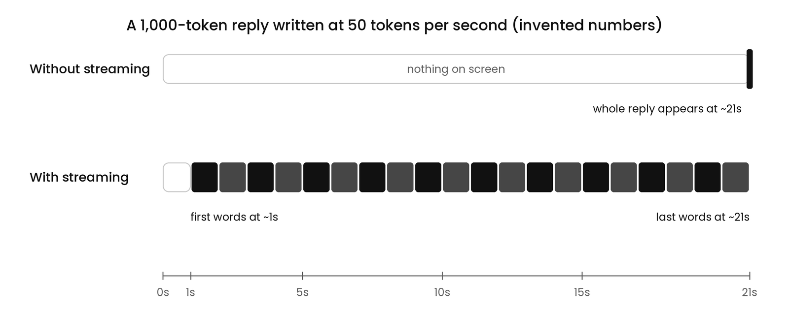
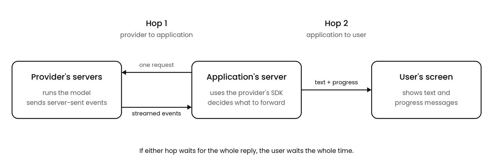
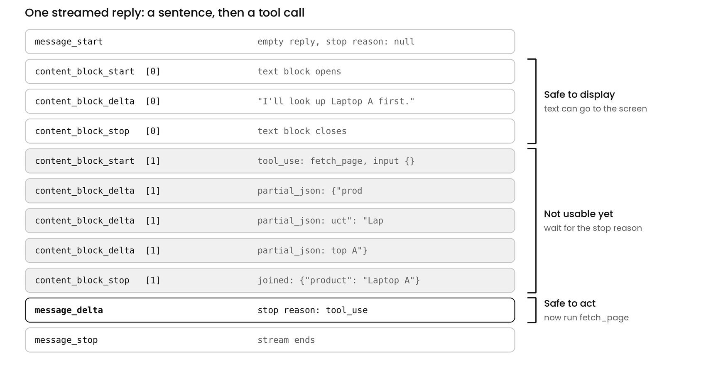
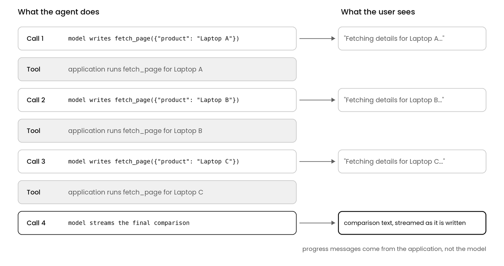

# Streaming

## What Is Streaming?

Streaming means receiving a model's reply in pieces while the model is still writing it, instead of receiving the whole reply at the end.

Without streaming, a call works like this. The application, meaning the code the developer wrote, sends a request. The model writes the entire reply token by token on the provider's servers, where the provider is the company that runs the model and lets applications call it over the internet. Only when the last token is written does the whole reply come back, in one piece. Until then, the user sees nothing.

With streaming, each piece of the reply is sent to the application as soon as the model writes it, so the application can show the first words while the model is still writing the rest.

Take a 1,000-token reply written at 50 tokens per second, the invented numbers from 1.3:

```
Without streaming:  ~1s reading the prompt + ~20s writing  →  the whole reply appears at ~21s
With streaming:     the first words appear at ~1s, and the rest fills in over the next ~20s
```



The total time is the same in both cases. Streaming does not make the model write any faster, because the model still writes one token per step. What changes is when the user first sees something: at about 1 second instead of about 21. That first moment is the time to first token from 1.3.

## Why Would A Call Nobody Watches Be Streamed?

Streaming also solves a problem that has nothing to do with the user's screen. A non-streaming call sends nothing back until the reply is complete, so a long reply means a connection that sits silent for a long time. An HTTP timeout is when a connection gets cut because no data has moved for too long, and any component along the path can enforce one:

- **The application's HTTP library.** The code that makes network requests typically gives up after waiting a set amount of time.
- **A proxy or load balancer in between.** These are pieces of network equipment that forward traffic, and they often drop connections that stay silent.

A streaming call keeps sending events while the model writes, so the connection never looks idle. Anthropic's streaming documentation says that for requests with large `max_tokens` values, the limit on how long a reply may be, its SDK requires streaming to avoid HTTP timeouts. An SDK, or software development kit, is a library that wraps the provider's API, the interface applications use to call the model, in functions for a particular programming language. So an agent may stream a call that no user ever sees, simply so that a long reply finishes at all.

## Who Sends What To Whom?

A streamed reply travels over two hops.

1. **Hop 1, provider to application.** The application's server uses the provider's SDK to send one request asking for a stream. The provider's servers send a series of events back over that same connection while the model writes. The SDK normally runs on the application's server, not in the user's browser, because calling the API needs a secret API key.
2. **Hop 2, application to user.** The application forwards the pieces it receives to the user's screen over its own connection to the browser. The SDK plays no part in this hop, because the SDK only talks to the provider.



Streaming has to happen on both hops. If the application receives a stream from the provider but waits for the whole reply before sending anything to the browser, the user still waits the full time.

## What Travels Down The Connection?

The events use a format called server-sent events, or SSE, a simple standard for a server to push a series of messages to a client over one open HTTP connection. Each event is plain text: a line naming the event, a line of data, and a blank line separating it from the next event. In Anthropic's API, the data line is JSON, and streaming is turned on by setting `"stream": true` in the request or by calling the SDK's stream helper.

Here is the stream for a short reply, "Paris is the capital of France.", with the JSON trimmed to the fields that matter:

```
event: message_start
data: {"type": "message_start", "message": {"content": [], "stop_reason": null, "usage": {"input_tokens": 25, "output_tokens": 1}}}

event: content_block_start
data: {"type": "content_block_start", "index": 0, "content_block": {"type": "text", "text": ""}}

event: content_block_delta
data: {"type": "content_block_delta", "index": 0, "delta": {"type": "text_delta", "text": "Paris is"}}

event: content_block_delta
data: {"type": "content_block_delta", "index": 0, "delta": {"type": "text_delta", "text": " the capital of France."}}

event: content_block_stop
data: {"type": "content_block_stop", "index": 0}

event: message_delta
data: {"type": "message_delta", "delta": {"stop_reason": "end_turn"}, "usage": {"output_tokens": 8}}

event: message_stop
data: {"type": "message_stop"}
```

Each event in order:

1. **`message_start` opens the reply.** It carries an empty message: no content yet, a stop reason of `null` because the model has not stopped, and the input token count.
2. **`content_block_start` opens a content block.** A reply is made of content blocks, separate pieces such as a block of text or a tool call, and each block has an `index` matching its position in the finished reply.
3. **`content_block_delta` carries the content.** A delta is a small addition to the block, and the application joins the deltas in order to rebuild the text. A delta can hold more than one token, so the pieces do not line up exactly with tokens.
4. **`content_block_stop` closes the block.** No more content is coming for that index.
5. **`message_delta` carries the final details.** This is where the stop reason first appears, along with the output token count. Anthropic's documentation notes that these counts are cumulative, meaning the running total rather than an increment.
6. **`message_stop` ends the stream.**

Two other kinds of events can appear. `ping` events can show up at any point and carry no content. `error` events can arrive in the middle of a stream, for example an `overloaded_error` when the provider is under heavy load. The documentation also says new event types may be added over time, so code should ignore event types it does not recognize instead of crashing.

## When Can The Code Trust The Reply?

1.3 set a rule: before the code uses a reply, it checks the stop reason, the field saying why the model stopped writing. `end_turn` means the model finished on its own, while `max_tokens` and `model_context_window_exceeded` mean the reply was cut off.

Without streaming, the reply and the stop reason arrive together, so the check runs before anyone sees or uses anything. With streaming, the two arrive at different times. The text comes in pieces from the first second, but the stop reason arrives only in `message_delta`, after the model has stopped writing:

```
1s:   "Here are the three laptops..."          ← text arrives
5s:   "...Laptop A costs $1,099..."            ← more text
...
18s:  "...and Laptop C is the"                  ← last piece of text
18s:  message_delta: stop_reason "max_tokens"  ← only now does the code learn the reply was cut off
```

For those 18 seconds, the code holds text without knowing whether the text will turn out complete. So the rule still applies, but it can only run once `message_delta` arrives. That splits what the code does with a reply into two groups:

- **Things that are safe before the stop reason arrives.** Showing text on the screen is the main one. If the reply turns out to be cut off, the user has seen an incomplete answer, and the application can mark it as incomplete or retry. Nothing irreversible has happened.
- **Things that must wait for the stop reason.** Anything that acts on the reply waits: parsing a tool call and running it, saving the answer as final, or sending it anywhere. These cannot be undone if the reply turns out to be incomplete.

## What Does A Streamed Tool Call Look Like?

A tool is a function the application allows the model to request, and a tool call is the model's written request to run one, as covered in 1.3. Here is the first call of the laptop agent from 1.5, an agent with one tool, `fetch_page`, a function that downloads a product page and returns its text. Suppose the model writes one short sentence and then a tool call whose input is the JSON `{"product": "Laptop A"}`. Trimmed, the stream looks like this:

```
event: message_start
data: {"type": "message_start", "message": {"content": [], "stop_reason": null}}

event: content_block_start
data: {"type": "content_block_start", "index": 0, "content_block": {"type": "text", "text": ""}}

event: content_block_delta
data: {"type": "content_block_delta", "index": 0, "delta": {"type": "text_delta", "text": "I'll look up Laptop A first."}}

event: content_block_stop
data: {"type": "content_block_stop", "index": 0}

event: content_block_start
data: {"type": "content_block_start", "index": 1, "content_block": {"type": "tool_use", "id": "toolu_01...", "name": "fetch_page", "input": {}}}

event: content_block_delta
data: {"type": "content_block_delta", "index": 1, "delta": {"type": "input_json_delta", "partial_json": "{\"prod"}}

event: content_block_delta
data: {"type": "content_block_delta", "index": 1, "delta": {"type": "input_json_delta", "partial_json": "uct\": \"Lap"}}

event: content_block_delta
data: {"type": "content_block_delta", "index": 1, "delta": {"type": "input_json_delta", "partial_json": "top A\"}"}}

event: content_block_stop
data: {"type": "content_block_stop", "index": 1}

event: message_delta
data: {"type": "message_delta", "delta": {"stop_reason": "tool_use"}}

event: message_stop
data: {"type": "message_stop"}
```



Four things differ from the text example:

1. **The reply has two blocks.** Index 0 is the sentence and index 1 is the tool call. The `content_block_start` for index 1 already names the tool, `fetch_page`, and gives the call an ID, but its input is empty, `{}`, because the arguments have not been written yet.
2. **The arguments arrive as fragments of a string, not as JSON.** The deltas are `input_json_delta` events, each carrying a `partial_json` piece, which Anthropic's documentation calls "partial JSON strings." No single piece is valid JSON, so `{"prod` cannot be parsed, and neither can `uct": "Lap`. The application joins the pieces in order, and only the joined string parses:

    ```
    "{\"prod" + "uct\": \"Lap" + "top A\"}"  →  {"product": "Laptop A"}
    ```

    The documentation says to join the pieces and parse once `content_block_stop` arrives for that block. The SDK's streaming helpers do this joining automatically.
3. **The stop reason is `tool_use`.** The model stopped on purpose to request a tool, and `tool_use` is the confirmation that the tool call is complete.
4. **A stream broken here leaves exactly the cut-off tool call from 1.3.** If the connection dropped after the second fragment, the application would hold `{"product": "Lap`, which cannot be parsed and cannot be repaired.

So the application runs a tool only after the stream ends, and only when the stream ends with `tool_use`. The end of the stream can say one of four things:

- **The stop reason is `tool_use`.** The model finished its tool call, so the application parses the arguments and runs the tool.
- **The stop reason is `max_tokens`.** The model hit the developer's output limit, and the tool call may be cut off. The application runs nothing and retries with a higher limit.
- **The stop reason is `model_context_window_exceeded`.** The model ran out of room in the context window, as covered in 1.5. The application runs nothing and shrinks the input before retrying.
- **The stream breaks before the end.** An `error` event arrives, or the connection drops, so there is no stop reason at all. The application runs nothing, because it has no confirmation of what the model meant to send.

Here is that decision with Anthropic's TypeScript SDK. `anthropic.messages.stream()` starts a streamed call, the `"text"` event fires for each piece of text, and `finalMessage()` waits for the whole stream and returns the finished message, throwing an error if no final message arrives. `sendToUser` stands for the application's own function that pushes an update to the user's screen, and `runTool` stands for the code that executes a tool. Types are simplified:

```ts
// agent/runCall.ts
import Anthropic from "@anthropic-ai/sdk";

const anthropic = new Anthropic();

export async function runCall(request: Anthropic.MessageCreateParams, sendToUser: SendToUser) {
  const stream = anthropic.messages
    .stream(request)
    .on("text", (textDelta) => sendToUser({ kind: "text", text: textDelta }));
  return stream.finalMessage();
}
```

```ts
// agent/step.ts
import { runCall } from "./runCall";
import { runTool } from "./tools";

export async function step(request: Anthropic.MessageCreateParams, sendToUser: SendToUser) {
  const message = await runCall(request, sendToUser);
  if (message.stop_reason === "tool_use") {
    const toolCall = message.content.find((block) => block.type === "tool_use");
    sendToUser({ kind: "progress", text: `Fetching details for ${toolCall.input.product}...` });
    return runTool(toolCall);
  }
  if (message.stop_reason === "max_tokens" || message.stop_reason === "model_context_window_exceeded") {
    throw new Error(`Incomplete reply: ${message.stop_reason}`);
  }
  return message;
}
```

`runCall` forwards every piece of text to the user the moment it arrives, which is safe because displaying text is reversible. `step` waits for the finished message and reads the stop reason before doing anything else. Only when the stop reason is `tool_use` does `step` look up the tool call, tell the user what is happening, and run the tool. An incomplete reply becomes an error that the calling code can retry, and a normal reply is returned as it is.

## What Does Streaming Change In An Agent?

The laptop agent answers "Compare the prices of Laptop A, Laptop B, and Laptop C." with four model calls:

```
Call 1  →  fetch_page({"product": "Laptop A"})
Call 2  →  fetch_page({"product": "Laptop B"})
Call 3  →  fetch_page({"product": "Laptop C"})
Call 4  →  "Here's how the three laptops compare..."   ← the only text the user reads
```

Calls 1 to 3 each produce a tool call that the user never sees, and only call 4 produces text the user reads. A common design is still to stream every call, for two reasons. Long calls stay alive, since the SDK requires streaming for large `max_tokens` values regardless of whether a person is watching. And the application learns what the agent is doing as the agent does it. The application forwards text blocks to the user as they arrive, never forwards a tool call's JSON fragments, and acts on tool calls only after the stream ends with `tool_use`. Streaming does not change the cost, because the same tokens are written either way.

Streaming only covers the model's tokens. While a tool runs, nothing comes from the provider, so without anything else the user would stare at an empty screen through every step except the last. The application fills those gaps on the second hop with its own progress messages, such as "Fetching details for Laptop A...", sent when a tool call is confirmed. The model never wrote that text. The SDK tells the application what the agent is doing, and the application tells the user.



## What Happens When A Stream Breaks?

A stream breaks when it stops before `message_stop`, for example because an `error` event arrives or the connection drops. The application then holds part of a reply and no stop reason, and what it can do depends on what the model was writing at that moment.

**The break happens while the model is writing a tool call.** Say call 2 breaks after two fragments, so the application holds `{"product": "Lap`. That fragment is not valid JSON, and nobody knows what the rest would have been. The application throws it away and sends call 2 again from scratch. Anthropic's documentation states the same rule: tool use blocks "cannot be partially recovered."

**The break happens while the model is writing text.** Say call 4, the final comparison, breaks halfway, after the user has already seen "Laptop A costs $1,099 and Laptop B costs $". The application can send call 4 again from scratch, which is the simplest option. Anthropic's documentation also describes asking the model to continue from where it stopped, so the half that was already written is not paid for and written again. How to ask depends on the model version, according to the documentation at the time of writing:

- **On Claude 4.5 and earlier models,** the application resends the conversation with the partial text placed as the start of the model's reply, and the model keeps writing that reply:

    ```
    user:       Compare the prices of Laptop A, Laptop B, and Laptop C.
    ...         (the tool calls and tool results)
    assistant:  Laptop A costs $1,099 and Laptop B costs $     ← the model continues from here
    ```

- **On Claude 4.6 and later models,** the documentation says not to place the partial text in the model's reply. Instead, the application adds a new user message describing what happened:

    ```
    user:  Your previous response was interrupted and ended with "Laptop A costs $1,099 and Laptop B costs $". Continue from where you left off.
    ```

Either way, the user may already be looking at half an answer, so the screen should mark the answer as interrupted until the rest arrives, rather than leaving it looking complete. Anthropic's documentation also recommends using the SDKs, which "handle streaming, accumulation, and reconnection," instead of parsing raw events by hand.

## What Comes Next?

Every part of this section kept returning to the tool call: the model's request that streams as fragments, waits for `tool_use`, and cannot be patched when it breaks. The next section covers tool calling itself: how the application describes a tool to the model, how a model that only writes text ends up triggering real work, and how the result finds its way back into the conversation.

Sources: [Streaming Messages, Claude Docs](https://platform.claude.com/docs/en/build-with-claude/streaming) · [TypeScript SDK helpers](https://github.com/anthropics/anthropic-sdk-typescript/blob/main/helpers.md)
