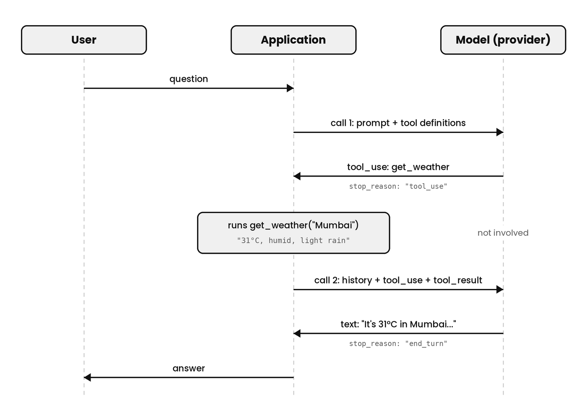

# Tool Calling

## Why Does A Model Need Tools?

A model only writes text. As covered in 1.1, the model reads a sequence of tokens, predicts the next token, appends it, and repeats until it stops. Nothing in that loop opens a web page, queries a database, or sends an email. Suppose a user asks:

```
What's the weather in Mumbai right now?
```

The model cannot know the answer. The model's knowledge comes from its training data, and "right now" is after that data was collected. Left alone, the model has two poor options: say it does not know, or guess. A guess written fluently looks the same as a fact, so the second option is the dangerous one.

The application, meaning the code the developer writes around the model, has no such limit. The application is ordinary code, and ordinary code can call a weather API, an interface that returns weather data over HTTP.

Tool calling connects the two. The model writes a structured request naming a function it wants run and the inputs to run it with. The application reads the request, runs the function, and sends the result back. The model then writes its answer using the result. A function offered to the model this way is called a tool.

**The model never runs anything. The model writes text that asks for something to be run, and the application decides whether to run it and then runs it.**

The model cannot run a function itself, for two reasons. The model runs on the provider's servers, while the function runs in the application, on the developer's server, and the model has no access to the application's code or network. And even in principle, the model's whole job is choosing tokens, so there is no step in the loop where code could be executed. Using a tool, for a model, means writing a description of a call.

## How Does The Model Know Which Tools Exist?

The model learns about tools from the prompt. Tool definitions are one of the five prompt components from 1.2. The developer passes them in a separate `tools` field of the request, and the provider places them into the prompt using its chat template, next to the system prompt. By the time the model reads anything, the tool definitions are more tokens in the sequence, and they cost input tokens on every call like the rest of the prompt.

Here is a weather tool in the format Anthropic's Messages API uses:

```json
{
  "name": "get_weather",
  "description": "Get the current weather for a city. Use this when the user asks about present conditions, not forecasts.",
  "input_schema": {
    "type": "object",
    "properties": {
      "city": { "type": "string", "description": "City name, e.g. Mumbai" }
    },
    "required": ["city"]
  }
}
```

A tool definition has three parts:

1. **`name`** is what the model writes when it wants this tool. The application matches the name against its own code to decide which function to run. The model has no other way to refer to the tool, so each name has to be unique within the request.
2. **`description`** is plain text telling the model what the tool does and when to use it. The model never sees the function's code, so the description is all it has to go on. A vague description such as "weather tool" leaves the model guessing about when the tool applies, while "not forecasts" tells the model when the tool does not apply.
3. **`input_schema`** describes the arguments the tool accepts, where an argument is a value the function needs to do its work, here the city. The schema is written in JSON Schema, a standard format for describing the shape of JSON data: which fields exist, what type each field has, and which fields are required. The model writes its arguments to fit that shape.

The function itself is not in the definition. Whether `get_weather` calls a real weather service, reads from a cache, or returns test data is invisible to the model. **To the model, the definition is the whole tool.**

So a tool has two halves that live in different places. The definition goes to the model on every call. The implementation, the actual function, stays in the application and never leaves the developer's server.

This split is worth keeping separate from the word "agent". The model is the language model on the provider's servers. The agent is the whole system: the model, plus the application code that holds the tool implementations, keeps the conversation history, and runs the loop. Tools are given to the model by the application, and both are parts of the agent.

```
Agent
├── Application (the developer's code)
│   ├── tool implementations   runs them
│   ├── conversation history   stores and resends it
│   └── the agent loop         decides when to call the model again
└── Model (on the provider's servers)
    └── reads: system prompt + tool definitions + history + current message
```

Because the model is stateless, the definitions are not handed over once and remembered. They travel with every request. **The application can therefore choose, call by call, which tools the model sees.** It can hide a `delete_file` tool from users without permission, or offer a `send_email` tool only after the user approves a draft. A tool missing from the request does not exist as far as the model is concerned.

## What Does A Tool Call Look Like?

When the model decides to use a tool, the model's reply is not free text such as "please run get_weather for Mumbai". Free text would force the application to guess what the model meant. The model writes the call in a format it was trained on, and the provider parses that output into a structured block before the response reaches the application. A response from Anthropic's API looks like this:

```json
{
  "stop_reason": "tool_use",
  "content": [
    { "type": "text", "text": "Let me check the current weather." },
    {
      "type": "tool_use",
      "id": "toolu_01A",
      "name": "get_weather",
      "input": { "city": "Mumbai" }
    }
  ]
}
```

The IDs in this section are shortened for readability. Real IDs are longer, and the provider generates them.

1. **`stop_reason: "tool_use"`** says the model stopped because it wants a tool run, not because it finished answering. The stop reason, the field saying why the model stopped writing, appeared in 1.3 and 1.6.
2. **The `tool_use` block** is the tool call itself. `name` says which tool to run, and `input` holds the arguments, written to fit the tool's input schema.
3. **`id`** is a unique label for this specific call. When the application sends the result back, it attaches this ID, so the model knows which call the result answers.
4. **The `text` block** is optional. The model sometimes writes a short sentence before the call and sometimes writes none.

With streaming, the same block arrives as a series of Server-Sent Events, as covered in 1.6. A `content_block_start` event announces the block with its `type`, `id`, and `name`, then `input_json_delta` events deliver the arguments as fragments of JSON text, and `content_block_stop` closes the block. The stop reason arrives last, in `message_delta`.

**The `tool_use` block says what the model wants. The `tool_use` stop reason says the model has finished writing and is waiting.** The application should act on the stop reason, not on the block alone. A reply can be cut off by `max_tokens` after a `tool_use` block has started, which leaves half-written arguments, the cut-off tool call from 1.3. Only when the stop reason is `tool_use` are the arguments complete.

## How Does The Result Get Back To The Model?

The result gets back the same way everything reaches a stateless model: in the prompt of the next call. Here is the whole weather question from start to finish. It takes two calls to the model.



*Image: `images/tool-calling-flow.png`*

**Call 1.** The application sends the system prompt, the tool definitions, and the user's message:

```json
{
  "system": "You are a helpful assistant.",
  "tools": [ { "name": "get_weather", "description": "...", "input_schema": { } } ],
  "messages": [
    { "role": "user", "content": "What's the weather in Mumbai right now?" }
  ]
}
```

The model replies with the tool call from the previous section, with `stop_reason: "tool_use"`.

**The application runs the tool.** The model takes no part in this step. The application sees the `tool_use` stop reason, finds the `tool_use` block, reads its `name` and `input`, and calls its own `get_weather` function with `Mumbai`. The function returns `"31°C, humid, light rain"`.

**Call 2.** The model kept nothing from call 1, so the application sends the whole conversation again, with two new entries in the history: the model's tool call, and the tool's result.

```json
{
  "system": "You are a helpful assistant.",
  "tools": [ { "name": "get_weather", "description": "...", "input_schema": { } } ],
  "messages": [
    { "role": "user", "content": "What's the weather in Mumbai right now?" },
    { "role": "assistant", "content": [
      { "type": "tool_use", "id": "toolu_01A", "name": "get_weather", "input": { "city": "Mumbai" } }
    ] },
    { "role": "user", "content": [
      { "type": "tool_result", "tool_use_id": "toolu_01A", "content": "31°C, humid, light rain" }
    ] }
  ]
}
```

1. **The tool call goes back as an `assistant` message.** The model reads it as something the model itself said, so the model knows it already asked for the weather.
2. **The result goes back as a `user` message, inside a `tool_result` block.** The chat template from 1.2 has only a few roles, and the result comes from outside the model, so it travels on the user's side of the conversation. The user never typed it.
3. **`tool_use_id` matches the `id` from call 1.** The match tells the model which call this result answers.
4. **The `tools` field is sent again.** Without it, the model would see its own earlier call to a tool that no longer exists in the prompt.

The model now has the data it needs and replies:

```json
{
  "stop_reason": "end_turn",
  "content": [
    { "type": "text", "text": "It's 31°C in Mumbai right now, humid with light rain." }
  ]
}
```

The `end_turn` stop reason means the model has finished, so the application shows the text to the user.

**This is the agent loop from 1.5: call the model, run any tool it asks for, append the call and the result to the history, and call again, until the stop reason is `end_turn`.** A task that needs three tools repeats the middle of the loop three times, and every pass resends the whole history.

## What Happens When A Tool Fails?

Tools fail. A weather service times out, a database rejects a query, or the model passes a city name that does not exist. The application has three ways to respond, and only one of them works well:

1. **Throw an error.** The agent loop crashes partway through the task. The user gets a generic error, and every earlier step is lost, even when the problem was small and recoverable.
2. **Send back nothing, or an empty result.** The model still has to reply. With no data and no explanation, the model may guess, and a fluent guess about the weather is exactly what tool calling was meant to prevent.
3. **Report the failure to the model as the result.** The model can then take a sensible next step: retry the call, try another tool, or tell the user plainly that the weather service is unavailable.

Anthropic's API supports the third option with the same `tool_result` block, marked as an error:

```json
{
  "type": "tool_result",
  "tool_use_id": "toolu_01A",
  "content": "Weather service unavailable: request timed out after 10 seconds.",
  "is_error": true
}
```

`is_error: true` is a flag telling the model the tool ran but failed, and `content` says what went wrong.

**The error message decides what the model can do next, so it is written for the model to read.** Compare two messages for the same call:

```
Error: 500
```

```
City "Mumbaii" not found. Check the spelling, e.g. "Mumbai".
```

From the first, the model cannot tell whether to retry, change the input, or give up. From the second, the model can correct the argument and call again. Stack traces and internal error codes belong in the application's logs, not in the result.

Some failures still need the application to step in, because the model cannot fix them:

- **Repeated failures.** A model can retry a broken call again and again, and every retry is a full call with a growing history. The application caps the number of retries or loop passes, and ends the task cleanly when the cap is reached.
- **Failures the user has to act on.** An expired login or a revoked permission cannot be repaired by the model. The application logs these failures and shows them to the user directly.

So the rule is to report tool failures to the model as results, and to keep crashes for failures in the loop itself.

## What If A Question Needs More Than One Tool Call?

The model decides how many tool calls a question needs. Take this question:

```
Compare the weather in Mumbai and Delhi.
```

The two lookups do not depend on each other, so the model can request both in one response. Anthropic calls this parallel tool use:

```json
{
  "stop_reason": "tool_use",
  "content": [
    { "type": "tool_use", "id": "toolu_01A", "name": "get_weather", "input": { "city": "Mumbai" } },
    { "type": "tool_use", "id": "toolu_01B", "name": "get_weather", "input": { "city": "Delhi" } }
  ]
}
```

Each call has its own ID, and the IDs are what keep the two results from being mixed up. The two calls here go to the same tool, but a response can just as well contain calls to different tools.

The application returns one `tool_result` per call, all together in the next user message:

```json
{ "role": "user", "content": [
  { "type": "tool_result", "tool_use_id": "toolu_01A", "content": "31°C, humid, light rain" },
  { "type": "tool_result", "tool_use_id": "toolu_01B", "content": "24°C, clear" }
] }
```

Anthropic's documentation sets three rules for this message. Every `tool_use` block gets exactly one `tool_result`. All the results go in the single user message that comes next. And the `tool_result` blocks come before any text in that message. So even a call that failed, or one the application chose not to run, still gets a result, marked with `is_error: true`.

How the application runs the calls is up to the application. Independent, read-only calls such as two weather lookups can run at the same time, for example with `Promise.all` in TypeScript, so two 2-second lookups take about 2 seconds in total instead of 4. Calls with side effects, such as writing files, may be safer to run one after another.

Not every question allows parallel calls. Take this one:

```
What's the weather where my next meeting is?
```

The model cannot call `get_weather` until it knows the city, so the calls happen in sequence, one pass of the loop each:

1. **Pass 1.** The model calls `get_next_meeting`, and the result is `"Client review, Pune, 3 PM"`.
2. **Pass 2.** Now that the model knows the city, it calls `get_weather` with `Pune`.
3. **Pass 3.** The model writes the final answer.

Each pass is a full call that resends the whole history, so sequential calls cost more time and more tokens than parallel ones. It is the same growth as the laptop agent in 1.5.

The developer can limit what the model does through the `tool_choice` field of the request. The default, `auto`, lets the model decide whether to call tools at all. Setting `disable_parallel_tool_use` inside `tool_choice` limits the model to at most one tool call per response. Anthropic's API also has options that force the model to call a tool, but at the time of writing, Anthropic's newest models do not support them, so the provider's documentation for the specific model is the place to check.

## What Comes Next?

Part 1 began with a model that can only predict the next token, and ends with that model taking part in actions in the world through the application. Each section added one property: the prompt is the model's only input, tokens set the cost, sampling makes output vary, the context window caps the sequence, streaming delivers output as it is written, and tool calling lets the model request actions it cannot perform itself.

Every one of those properties puts pressure on the same place: the prompt. Tool definitions, tool results, and history all compete for the same window, and every call resends all of them. Part 2 covers context engineering, the practice of deciding what goes into the prompt on each call, and what stays out.

Sources: [Parallel tool use, Claude Docs](https://platform.claude.com/docs/en/agents-and-tools/tool-use/parallel-tool-use)